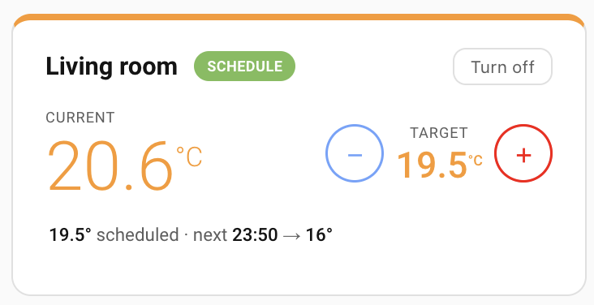
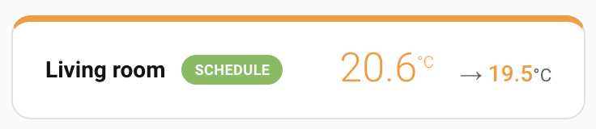
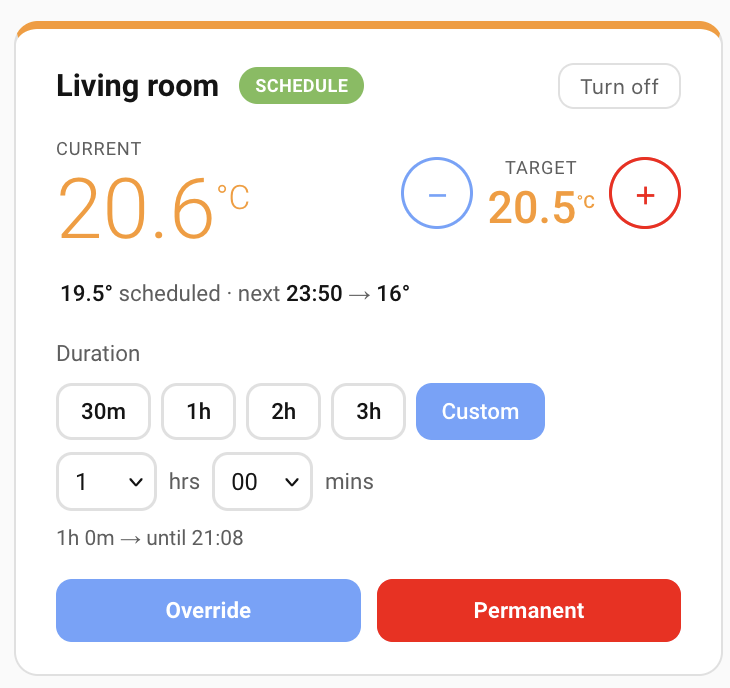
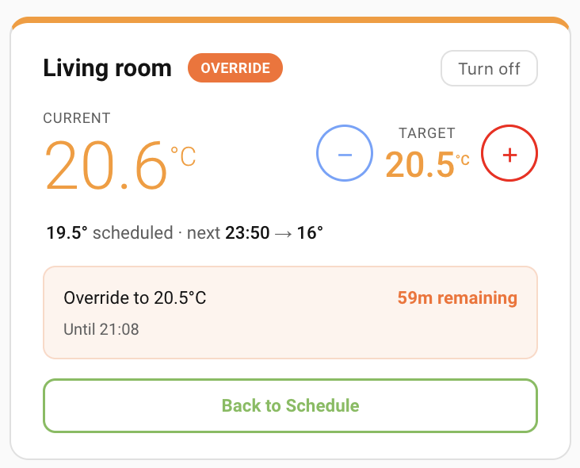
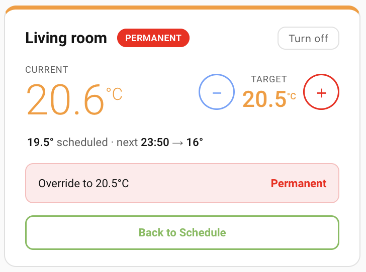
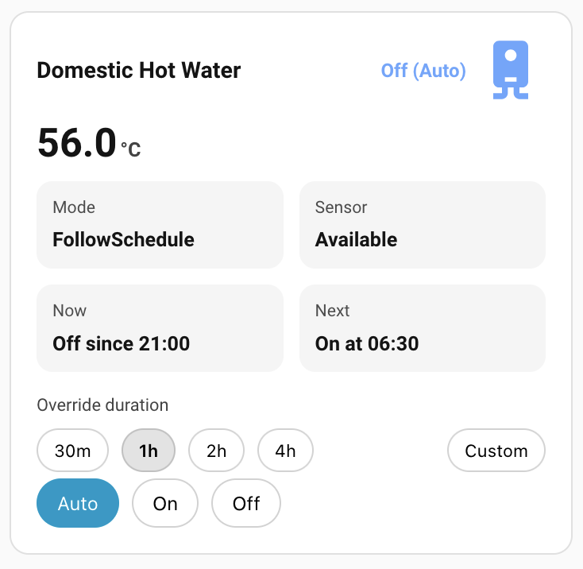
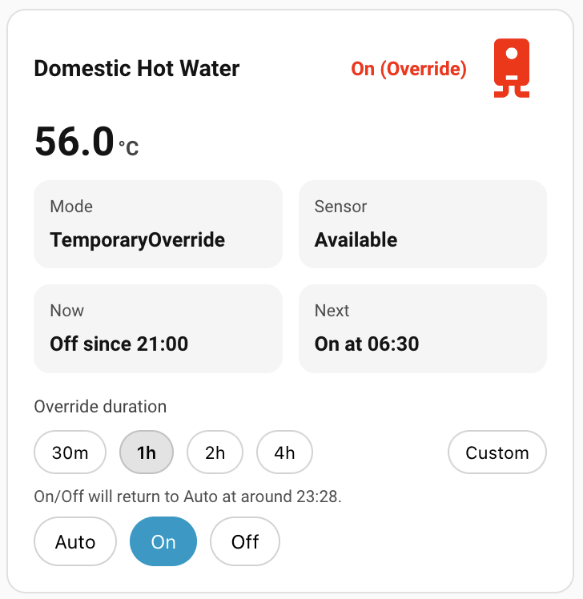

# Evohome Cards

Custom Lovelace cards for Honeywell Evohome:
- `custom:evohome-zone-card` for climate zones
- `custom:evohome-hot-water-card` for domestic hot water (DHW)

> [!NOTE]
> This repo was vibecoded.

## Features

- Zone card:
  - Live zone temperature and target display
  - Temporary override with quick/custom durations
  - Permanent override and return-to-schedule controls
  - Optional HVAC on/off toggle
  - Optional compact row layout
  - Optional temperature color pills
- Hot water card:
  - Current DHW temperature and schedule state display
  - Mode controls (`auto` / `on` / `off`)
  - Override duration controls with quick presets + custom dropdowns
  - Staged edits with `Apply` / `Discard`
  - Automatic return to `auto` at selected end time

## Screenshots

### Zone Card

### Schedule



### Compact



### Override Options



### Temporary Override



### Permanent Override



### Hot Water Card

### Schedule



### Override



## Installation

### HACS (Custom Repository)

[](https://my.home-assistant.io/redirect/hacs_repository/?owner=j0hnsmith&repository=evohome-cards&category=plugin)

or

1. In Home Assistant, open HACS.
2. Go to `⋮` -> `Custom repositories`.
3. Add this repository URL and select category `Dashboard`.
4. Install `Evohome Cards` from HACS.
5. Refresh browser cache after install.

### Manual

1. Download `evohome-cards.js` from this repository.
2. Copy it to your Home Assistant `www` directory:
   - `/config/www/evohome-cards.js`
3. Add it as a Lovelace resource.

Resource YAML:

```yaml
url: /local/evohome-cards.js
type: module
```

Resource UI path:
1. `Settings` -> `Dashboards`
2. `⋮` -> `Resources`
3. `Add resource`
4. URL: `/local/evohome-cards.js`
5. Type: `JavaScript Module`

4. Refresh browser cache (or hard reload).
5. Add the card to a dashboard.

## Zone Card YAML

```yaml
type: custom:evohome-zone-card
entity: climate.living_room
```

## Zone Card Full Config YAML

```yaml
type: custom:evohome-zone-card
entity: climate.living_room
name: Living Room
show_hvac_toggle: true
show_accent_bar: true
temp_pills: false
compact: false
```

## Hot Water Card YAML

```yaml
type: custom:evohome-hot-water-card
entity: water_heater.domestic_hot_water
name: Domestic Hot Water
```

The hot water card reads Evohome DHW attributes such as:
- `operation_mode` and `operation_list` (`auto`, `on`, `off`)
- `status.setpoints.this_sp_*` and `status.setpoints.next_sp_*`
- `status.state_status`
- `status.temperature_status`

Hot water overrides (`On` / `Off`) require an override duration selection in the card (quick presets or custom). If the requested duration crosses the next schedule change, the card reapplies the override at `next_sp_from + 1 minute` and still switches back to `auto` at the selected end time.
Mode/duration edits are staged as pending changes and only sent when you press `Apply` (use `Discard` to cancel pending edits).

Reason for the `+1 minute` reapply:
- Evohome DHW `set_operation_mode` does not support a custom duration and non-`auto` modes naturally end at the next schedule setpoint.
- Reapplying slightly after the setpoint boundary avoids racing the schedule transition exactly on the same timestamp.

## Zone Card Config Options

| Option | Required | Type | Default | Description |
|---|---|---|---|---|
| `entity` | Yes | `string` | none | Evohome climate entity (for example `climate.living_room`) |
| `name` | No | `string` | entity friendly name | Overrides displayed room name |
| `show_hvac_toggle` | No | `boolean` | `true` | Shows the `Turn on` / `Turn off` button |
| `show_accent_bar` | No | `boolean` | `true` | Shows top accent bar color based on current temperature |
| `temp_pills` | No | `boolean` | `false` | Uses tinted pill backgrounds for current/target temperatures |
| `compact` | No | `boolean` | `false` | Starts in compact status-only view; expands on click |

## Hot Water Card Config Options

| Option | Required | Type | Default | Description |
|---|---|---|---|---|
| `entity` | Yes | `string` | none | Evohome DHW water heater entity (for example `water_heater.domestic_hot_water`) |
| `name` | No | `string` | entity friendly name | Overrides displayed name |

## License

MIT. See [LICENSE](LICENSE).
